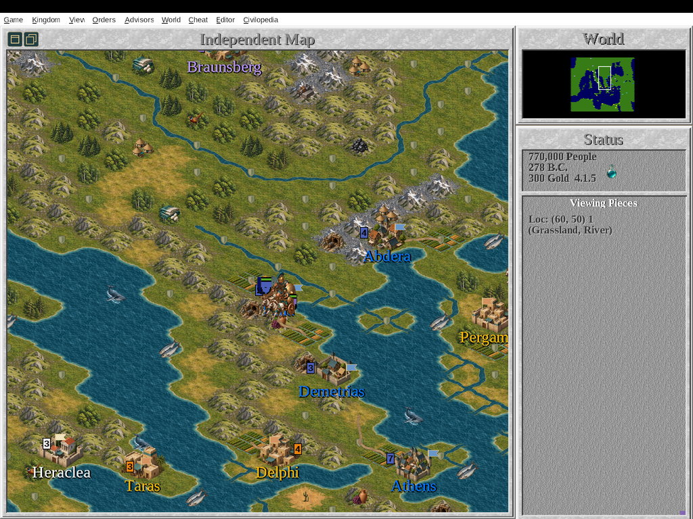
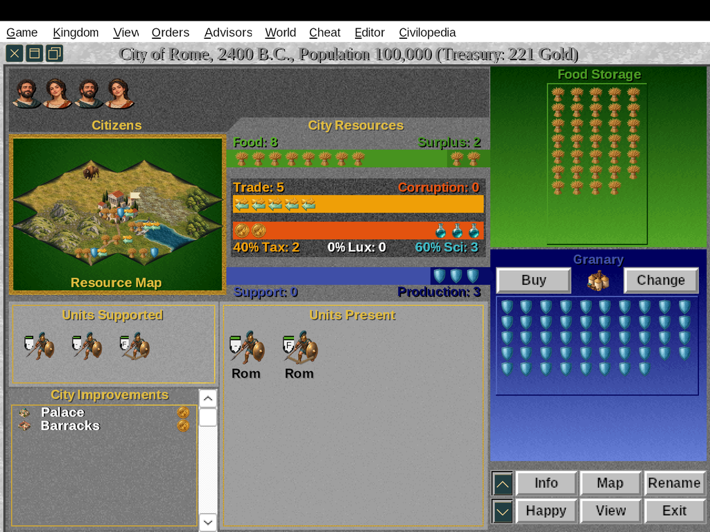

# OpenCiv2

Goal: reconstruct the source of *Sid Meier's Civilization II: Multiplayer Gold Edition*
(1998) as portable C++ that builds and runs natively on Linux, macOS and Windows.

## Download and play

You need your own copy of Civilization II Multiplayer Gold Edition: installed (or a `.zip` of
the installed folder), on CD, or a disc image (`.cue`/`.bin`). Download the program for your system:

- **Windows:** [OpenCiv2-windows.zip](https://github.com/openciv2/openciv2/releases/download/latest/OpenCiv2-windows.zip): unzip and run `OpenCiv2.exe`.
- **macOS** 11+: [OpenCiv2-macos.zip](https://github.com/openciv2/openciv2/releases/download/latest/OpenCiv2-macos.zip): unzip and open `OpenCiv2.app`. The first time macOS
  blocks it: System Settings > Privacy & Security > "Open Anyway".
- **Linux** x86-64: [OpenCiv2-linux-x86_64.tar.gz](https://github.com/openciv2/openciv2/releases/download/latest/OpenCiv2-linux-x86_64.tar.gz): unpack and run `OpenCiv2/OpenCiv2`.

The first time, it finds your copy of the game (or asks where it is) and sets it up, music
included when it comes from the CD or a disc image. `--setup [FOLDER, GAME.zip or IMAGE.cue]`
sets it up again. From a disc image, each music track ends at the silence before the next one where
the cue sheet's track marks are a second or two off (`--no-fix-cue-gaps` with `--setup` cuts
them exactly where the cue sheet says).

OpenCiv2 fixes the original game's bugs ([BUGS.md](docs/BUGS.md)) and adds the interface
improvements of FoxAhead's [CIV2UIA](https://github.com/FoxAhead/Civ2-UI-Additions) (mouse
wheel, scrolling lists, more figures in the advisors, quick information with Ctrl ...:
[EXTRAS.md](docs/EXTRAS.md)), and, off unless switched on, its rule changes (Go To past enemy
units, moving a stack's units of a type together, higher limits for gold, population and the
map ...). OpenCiv2 Options, the last choice of the game's main menu, lets you choose: the bug
fixes (on by default; each one can be switched in `CIV.INI` too), Classic graphics (the
original's pictures) or HD graphics, sharp text and interface on high-resolution screens (on
by default), full screen, the rule changes and the interface additions, kept in `CIV.INI`
([EXTRAS.md](docs/EXTRAS.md#openciv2-options)).

OpenCiv2's own texts (its options, dialogs and set-up) can be translated: English, German,
Latin, Greek (Ελληνικά), Esperanto and Traditional Chinese (繁體中文) come with it (first drafts), chosen in
OpenCiv2 Options > Language. The game's own
texts come in the language of your Civilization II, or in that of a translation that has them:
all of these translate the whole game ([TRANSLATING.md](docs/TRANSLATING.md)). Where your
copy lacks one of the game's text files, OpenCiv2 uses its own English of it, written for it.

The game opens in a window filling the screen. To play full screen, see [EXTRAS.md](docs/EXTRAS.md#screen-scale).

Optionally, the map can be drawn with new high-resolution art
([openciv2-assets](https://github.com/PeterJohnson/openciv2-assets), which comes with OpenCiv2's
releases):
untick Classic graphics in OpenCiv2 Options (Graphics and screen), or start it with `--hd`
([HD-GRAPHICS.md](docs/HD-GRAPHICS.md); a prototype).

### Multiplayer

All of the original's multiplayer modes are supported: hot seat on one computer, and network
games on a local network or over the Internet (Multiplayer Game > Network or Internet). Players
can mix OpenCiv2 on any system with the original game, and either one can host. Network games
use TCP port 4993, and UDP port 4994 to find games on a local network.

## Build and run

To build it yourself, install your copy of Civilization II in `~/Civ2` (the directory with
`civ2.exe`, `Tiles.dll`, the `.TXT` files …), or point `CIV2_GAME` at it.

```sh
git clone https://github.com/openciv2/openciv2 && cd openciv2
make            # -> build/OpenCiv2 (several minutes; the first time it downloads wasi-sdk,
                #    wabt and the libraries' sources into tools/toolchain, and the HD art's
                #    source into ~/.cache/openciv2, from which it makes data/native/hd)
make run        # plays the game in ~/Civ2 (or: make run GAME=/path/to/Civ2)
```

`make` (or `make build`) builds the native executable for the local machine without
Docker. `make native` is the separate 32-bit Linux development build; it needs
working Docker and the development images built with `make images`. See
[DEVELOPMENT.md](docs/DEVELOPMENT.md#tooling) for those development targets.

The HD graphics' art is not in the repository: the builds make it first (`make hd-art`,
[HD-GRAPHICS.md](docs/HD-GRAPHICS.md#what-the-art-is)), fetching the files of openciv2-assets
at its pinned commit once (git; 316 MB), building its pack and encoding its pictures as WebP in
Docker, or, without Docker, with Python's Pillow and numpy and `cwebp` (the `webp` package;
`brew install webp`). Later builds
take it from `~/.cache/openciv2`, offline. `make HD_ART=` builds without it (Classic graphics
only).

OpenCiv2's own music and heralds (played where the game folder lacks the CD's music and
heralds) are not in the repository either: the builds fetch them from
[openciv2/openciv2-assets](https://github.com/openciv2/openciv2-assets) at its pinned commit
once (`make own-assets`; about 30 MB, the music already Ogg Vorbis as the game plays it, so
nothing is converted and nothing needs installing but Python 3). Later builds take them from
`~/.cache/openciv2`, offline. `make OWN_ASSETS=` builds without them.

What to install first:

- **macOS:** `xcode-select --install` (compiler and make) and `brew install sdl2`.
- **Linux:** a C compiler, make, Python 3 and `libsdl2-dev` from the package manager.
- **Windows:** in an [MSYS2](https://www.msys2.org) **UCRT64** shell, `pacman -S git make python
  mingw-w64-ucrt-x86_64-gcc mingw-w64-ucrt-x86_64-SDL2`, then `make` and `make run` there as
  above (the game is looked for in `%USERPROFILE%\Civ2`). MSYS2's own `python`, not
  `mingw-w64-ucrt-x86_64-python`: the build runs `sdl2-config`, a shell script, which a Windows
  Python cannot start. Outside MSYS2, play with `tools\run-civ2.bat [GAMEDIR]` from a Command
  Prompt or by double-clicking it.

`make windows` cross-compiles `build/OpenCiv2.exe` on Linux (it also downloads SDL2's MinGW
release): the one file the release has, SDL2 and the fonts built in.

## Browser version

`make web` builds the game for web browsers into `build/web`: a static site (a page, its
scripts, the game as a 2.9 MB WebAssembly module, the fonts) with no server-side code. Serve
that folder from any web server, e.g.

```sh
make serve        # builds build/web (first time: downloads Binaryen into tools/toolchain)
                  # and serves it: open http://localhost:8000 (PORT=8080 for another port)
```

More details in [BROWSER.md](docs/BROWSER.md).

## Status

Playable. Every function of the game that can run has source; the only parts not reconstructed
are the original's MSVC runtime (replaced by the platform's C library) and unreachable 16-bit
leftovers. All 44 recorded scenarios match the original exactly, pixel for pixel, with the same
sounds and videos asked for. They run 72% of the game's functions (78% leaving out networking);
playing sound and video and the High Council's window can't be compared under Wine. Multiplayer is supported and compatible with the original: OpenCiv2 and
the original game play each other on a LAN or over the Internet, either one hosting. Automated
tests (`tools/xdnet/nettest.py`) play two or three games against each other, including
diplomacy, saving and loading, players leaving and rejoining, and 50-turn games
(`docs/xdaemon-protocol.md`).

The code is being modernized step by step, each step checked by the harness: it compiles as
strict C++, keeps the original's data layout, has its classes as C++ class hierarchies with
member functions, typed callbacks, structured control flow, smaller functions and named
constants (enums for unit types, improvements, advances, orders, network messages ..., flag
constants for units, cities, treaties, tiles) and its state grouped by subject (records such as
`prefs.difficulty` or `net.session_phase` where the original's variables lie together, a header
per subject, the read-only texts and tables `const`), and releases bound to scope (a local
dialog, surface or file released by a guard on every path out of the function instead of on each
return). Its logic has recorded unit tests (`make test`: 11,119 calls of 880 of the game's
functions recorded from the replays, run again and compared in seconds, no game files needed).
That completes step 6 of the clean-up.

Details: [STATUS.md](docs/STATUS.md) (progress and verification) and
[DEVELOPMENT.md](docs/DEVELOPMENT.md) (the code's layout, the approach and the tooling).

| | |
| --- | --- |
|  |  |
|  |  |
|  |  |
|  |  |

*The native build: the main menu, a city, the World War II scenario, the Top Five Cities, a foreign
leader receiving an envoy and London's city view with its wonders; last, the map and a city with
the optional HD graphics.*
